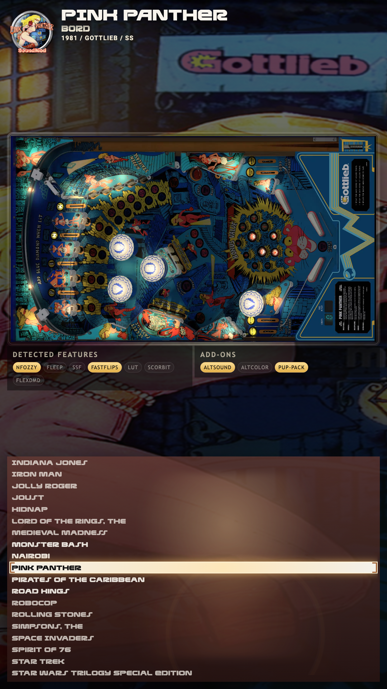
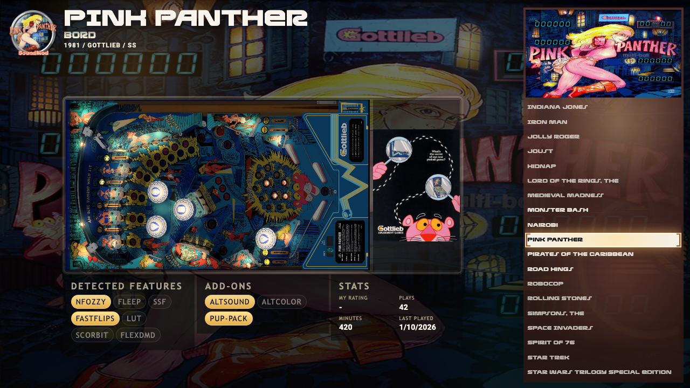

# Texal

A theme for a desktop or a cabinet.  The backglass of the table you are on fills the screen, dimmed.  Over it, a framed preview of the playfield sits in the middle with the table's wheel, name, authors, year, manufacturer and type above it.  A list of tables runs down the right with the selection in the middle row.

On a tall cabinet screen the list goes under the preview.

Two panels of tags sit below the preview, one for the features the table was built with and one for the add-ons it ships with.  A tag is lit when the table has it and dim when it does not.  When a table has a rating from VPinPlay, it shows beside the title.

The preview plays the table's playfield video, or shows its image, as Playfield Media Priority in VPinFE's settings asks for.  The header above the list does the same with the backglass, as Backglass Media Priority asks.  Set either to Image to keep the picture.

The separate Texal-Flyer theme is part of Texal now.  With Show the flyer on, the table's flyer sits beside the preview and a stats panel joins the other two.

## Install

Open Themes in the Console, find Texal, and press Install.  Then press Make Active and restart VPinFE.  It needs VPinFE 3.0 or later.

## Settings

These are on the Themes page in the Console, under Texal's settings.

| Setting | What it does |
| --- | --- |
| Show the flyer | Shows the table's flyer beside the preview, and a third panel with your own stats for the table: rating, plays, minutes and last played.  A table with no flyer shows the preview alone.  Off by default.  It replaces the separate Texal-Flyer theme. |
