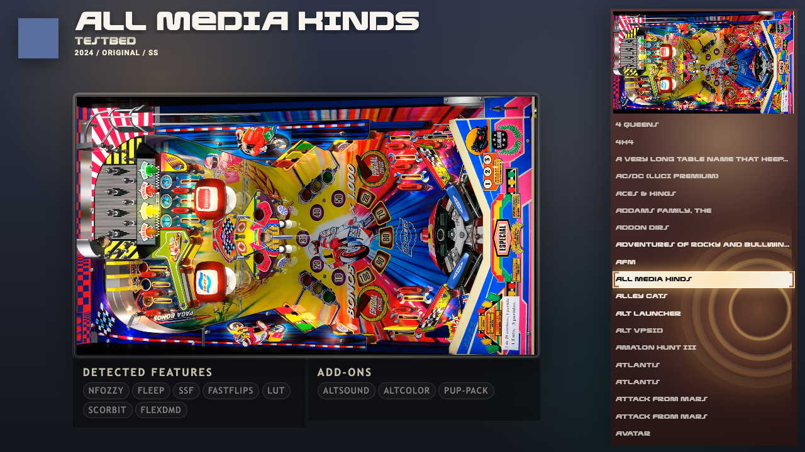

# Texal

A desktop and cab theme. The selected table's backglass fills the screen, dimmed. Over it, a
framed preview of the playfield sits in the middle with the table's wheel, name, authors,
year, manufacturer and type above it, and two panels of tags below it: the features the
table was built with and the add-ons it ships with. A list of tables runs down the right
with the selection in the middle row, and the table's backglass video plays above it. A step
slides the list one row, and a bright band sweeps the row the selection lands on. On a tall
cabinet screen the list goes under the preview.



Requires VPinFE 3.0 or later (`min_vpinfe` in `manifest.json`). This is the 3.0 rebuild of
Texal, so its version is 2.0.0. The separate Texal Flyer theme is part of this one now: turn
on **Show the flyer**.

## What is here

```
manifest.json         name, version, author, min_vpinfe and the windows the theme draws
options.json          the options a person can change, with their defaults
index_playfield.html  the playfield page
style.css             the look
theme.js              the behavior
gsap.min.js           GSAP, which moves the page on a step
fonts/                Roboto Bold, Rocket Command Expanded and Rocket Command Gradient
preview.png           shown in the theme list
```

The page is laid out on a box of fixed shape, 16:9 on a wide screen and 9:16 on a tall one,
centered in the window. Most lengths in `style.css` are multiples of `--r`, a fixed fraction
of the box, so the page looks the same at any size the box fits. The backglass behind it
fills the screen with `object-fit: cover`, so it is cropped, not stretched, on a screen of
another shape.

The playfield picture and video are shown as stored, contained in the frame. Texal does not
turn them, so there is no use for the playfield media rotation setting.

## The two JSON files

JSON cannot carry comments, so what each field does is here.

`manifest.json`

| Field | What it does |
| --- | --- |
| `name`, `version`, `author`, `description` | Shown in the theme list. `version` is the theme's own release number |
| `preview_image` | The screenshot shown in the theme list |
| `type` | `both`: the theme adapts to a desktop screen or a cabinet |
| `min_vpinfe` | The oldest VPinFE that can run the theme |
| `windows` | The pages the theme draws. Texal draws `playfield` only, so core's backglass and score view pages are used |
| `change_log` | A string, shown as "What's new" to someone installing or updating the theme |

`options.json` declares what a person can change under the theme's settings.

| Key | Type | Default | What it does |
| --- | --- | --- | --- |
| `enable_table_video` | boolean | on | Plays the table's playfield video in the preview, for a table that has one. The picture shows first and the video replaces it a moment later, so stepping quickly never starts a video. A table without a video shows its picture |
| `enable_selector_header_bg_video` | boolean | on | Plays the table's backglass video above the list, for a table that has one. A table without one shows its backglass picture. On a tall screen the area above the list is not drawn, so the option has no effect there |
| `showFlyer` | boolean | off | Shows the table's flyer beside the preview, and adds a third panel with the person's own stats for the table: rating, plays, minutes and last played. A table with no flyer shows the preview alone |

The keys are the ones Texal had in 2.x, so a person's choices carry over. `showFlyer` is new,
and replaces the separate Texal Flyer theme.

## The five parts of theme.js

`theme.js` has five parts, in this order, each commented:

1. **Options** - read what `options.json` declared from `vpin.themeConfig`.
2. **The backglass** - two stacked pictures. The new table's backglass loads into the one at
   the back and then fades in over the other. A table with no backglass fades the screen to
   black.
3. **The selection** - draw the selected table: wheel, name, VPinPlay rating when it has
   one, authors, year / manufacturer / type, the preview, the flyer, the backglass above the
   list, and the tags (Nfozzy, Fleep, SSF, FastFlips, LUT, Scorbit, FlexDMD under Detected Features;
   AltSound, AltColor, PuP-Pack under Add-ons). A tag the table has is lit; one it lacks is
   dim. A name over 20 characters is set smaller. In the collection picker the page shows
   the collection's name, its table count and its picture.
4. **The list** - nineteen rows with the selection in the middle one. A list shorter than
   that leaves the outer rows empty and keeps the selection in the middle.
5. **Motion** - on a step the list slides one row and a band sweeps the selected row; on a
   step or a page jump the heading, preview and tag panels fade in. Two slow loops, a drifting
   glow and rings spreading from the list, run for as long as the page is open. Without GSAP
   the page still draws.

Then **Messages**: hand every message to core, then redraw.

The VPinPlay rating is read from `entry.ext.vpinplay`, which core fills in with a 0 to 5
average and a count. It shows as stars beside the name and is hidden when the table has no
rating.

## The page

| Element | What it holds |
| --- | --- |
| `.backdrop-art` (two) | The backglass, one fading into the other |
| `#selection` | The layout box; everything except `#empty` is inside it |
| `#wheel` | The table's wheel picture; empty, and so hidden, when the table has none |
| `#name`, `#rating`, `#authors`, `#meta` | The title, the VPinPlay rating, the authors, and year / manufacturer / type |
| `#preview` | The playfield picture or video, drawn by `theme.js` |
| `#flyer` | The flyer, when **Show the flyer** is on and the table has one |
| `#features-heading`, `#features` | The "Detected Features" heading (core's own wording) and its tags |
| `#addons-heading`, `#addons` | The Add-ons heading and its tags |
| `#stats-heading`, `#stats` | The Stats heading and the person's own stats; shown only with **Show the flyer** |
| `#mark` | The backglass video, or its picture, above the list |
| `#list`, `#selector` | The nineteen rows and the frame over the middle one |
| `#empty` | "No tables found", shown when the list is empty |

The page's outermost element carries `vpinfe-upright`, so core can turn the whole page for a
cabinet screen mounted on its side. The stage is styled by class, not by id, so the rules in
`vpinfe-style.css` that size it for a turned screen still win.

## What core does, so this theme does not

| Core handles | The theme's part |
| --- | --- |
| Keys, buttons and the remote: stepping, paging, the menu and the collection picker | Launch on `select` |
| Moving the selection and wrapping around the list | Draw the selected table (`activeList().current`) and the rows around it (`indexAfter`) |
| Choosing the table's media and its fallbacks | Ask for the playfield, the backglass, the wheel, the flyer and the two videos by name |
| Audio for the selected table | Nothing |
| Preloading the neighbors | Nothing |
| Turning the page for a sideways cabinet screen | `vpinfe-upright` on the stage |
| The loading indicator while a table starts | Restyle `.vpinfe-launch-spinner` |
| Attract mode | Nothing |
| The backglass and score view pages | Nothing: Texal ships none, so core's are used |

## Opt-outs

Texal uses none. There is no `config.json`.
